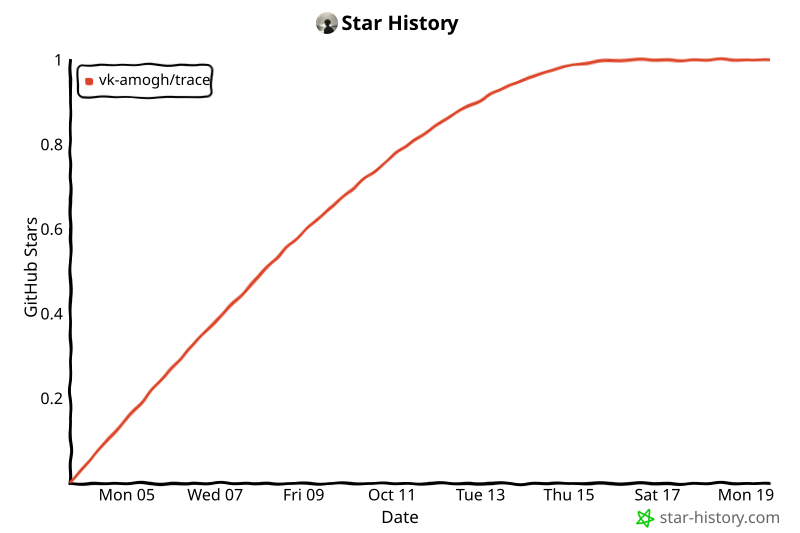

<p align="center">
  <picture>
    <source media="(prefers-color-scheme: dark)" srcset="docs/assets/logo-wordmark-dark.svg">
    
  </picture>
</p>

<p align="center">
  <a href="https://www.npmjs.com/package/trace-sec"></a>
  <a href="https://github.com/VK-Amogh/TRACE/actions/workflows/ci.yml"></a>
  <a href="https://VK-Amogh.github.io/TRACE/"></a>
  <a href="https://github.com/VK-Amogh/TRACE/blob/main/LICENSE"></a>
  <a href="https://github.com/VK-Amogh/TRACE/stargazers"></a>
</p>

<p align="center">Full-repo audit in 0.26 s on local CPU. Zero tokens. No cloud.<br>
If it is useful to you, a ⭐ helps other people find it.</p>

**TRACE** is the radar, your coding agent is the mechanic. TRACE parses the
repository into an Attack-Path Model, correlates real vulnerabilities
(BOLA, BFLA, SSRF, injection, …), and hands structured findings to
Claude Code, Cursor, or Codex over MCP — then *proves* each fix with a live
verification oracle instead of assuming it worked.

```bash
npx trace-sec audit .
```

```bash
trace scan ./backend --target http://localhost:8000
trace explain TR-BOLA-001
trace verify TR-BOLA-001
```

```bash
claude mcp add trace -- npx -y trace-sec mcp
```

Every command on one page: **[CLI reference](https://VK-Amogh.github.io/TRACE/cli/)**.
AI agents start at [`AGENTS.md`](AGENTS.md) and the
[security harness skill](https://VK-Amogh.github.io/TRACE/harness/).

## Quick install

Install globally in one command — runtimes and dependencies configure automatically:

```bash
# Global CLI via npm (available globally as 'trace' in any terminal)
npm install -g trace-sec

# Or instant zero-install execution via npx
npx trace-sec

# Windows PowerShell one-liner
irm https://raw.githubusercontent.com/VK-Amogh/TRACE/main/install.ps1 | iex

# macOS & Linux one-liner
curl -fsSL https://raw.githubusercontent.com/VK-Amogh/TRACE/main/install.sh | bash
```

Once installed, simply open any terminal or CMD and type `trace` to launch!

## Agent skills

You don't have to install TRACE yourself: install the skill and your coding
agent sets TRACE up. Two skills in the open `SKILL.md` format work in any agent
harness (Claude Code, Codex, Cursor, Gemini CLI, Copilot, OpenCode,
Antigravity, …):

```bash
npx skills add VK-Amogh/TRACE --skill trace   # universal installer, 75+ agents
npx trace-sec install-skill                   # or: both skills + MCP config, zero-dependency
```

| Skill | What it is for |
|---|---|
| `trace` | **Setup**: the agent installs and configures TRACE (runtime, MCP, local target, scan scope), runs scans and fixes setup problems |
| `trace-fix` | **Findings**: triage, prioritize, fix by category and language, verify, report, plus top security guidance (OWASP/CWE, coverage limits, CI) |

They also ship inside the `trace-sec` npm package and the PyPI wheel, so they
are versioned with the tool. Details: [Agent skills](https://VK-Amogh.github.io/TRACE/skills/).

## What it catches

| ID | Category | Root cause it proves |
|---|---|---|
| `TR-BOLA` | Broken Object-Level Authorization | `id` lookup without tenant scoping, shown via dual-identity differential test |
| `TR-BFLA` | Broken Function-Level Authorization | Admin endpoint reachable without role check |
| `TR-AUTH` | Missing / broken authentication | State-changing endpoint with no auth middleware |
| `TR-SSRF` | Server-Side Request Forgery | User-controlled URL dispatched without validation |
| `TR-INJ` | Injection (SQLi / command) | Unparameterized query or shell execution, triple-signal confirmed |
| `TR-MASS` | Mass assignment | Untrusted dict bound straight onto an ORM model |
| `TR-TRAV` | Path traversal | File operation on an unsanitized user path |
| `TR-SSTI` | Template injection | Unescaped user input rendered server-side |
| `TR-CORS` | CORS misconfiguration | Wildcard origin reflected with credentials |
| `TR-DESER` | Unsafe deserialization | Untrusted bytes fed to an object-graph deserializer |

TRACE reads source code in Python, JavaScript/TypeScript, Java/Kotlin, Go, PHP,
Ruby, Rust, C# and Dart, and skips markup, styles, data/config files and
build output before opening them ([what TRACE scans](https://VK-Amogh.github.io/TRACE/ingestion/)).
Secrets, dependency CVEs and cloud/IaC configuration are not assessed.

## Benchmarks

Onecrew production repo (189 files, 39 endpoints), offline, zero tokens —
recorded in [`docs/BENCHMARKS.md`](docs/BENCHMARKS.md):

| Stage | Time |
|---|---|
| AST ingestion | 0.049 s |
| APM graph assembly | 0.071 s |
| Vulnerability analysis | 0.141 s |
| **End-to-end audit** | **0.261 s** |

Hardcore multi-service testbed (15 endpoints, 12 planted flaws):
**15.79 ms static pipeline, 100% precision / 100% recall.**
Every `trace audit` prints per-stage timings, so these numbers are
reproducible on your machine — no lab-only claims.

Covered by **250+ automated tests** (`pytest tests/`).

## Lite or Full

| | **Lite** (default) | **Full** |
|---|---|---|
| Install | `pip install -e .` | `pip install -r requirements.txt` |
| Size | ~2 MB, no torch | ~1 GB (torch, transformers, onnxruntime) |
| Runs on | any CPU, 4 GB RAM | 8 GB RAM recommended |
| Detection | AST dataflow + live probes | + SecureBERT 2.0 neural scoring and Laya router |
| Choose it | contributors, CI, quick audits | maximum confidence on your own machine |

`trace doctor` reports which mode is active on your machine.

## Why trust a finding

```text
Confidence = 1 − (1 − P_SecureBERT) × (1 − P_AST) × (1 − P_dynamic)
```

- **Triple match (~99.8%)**: AST dataflow finds the sink, SecureBERT flags the
  pattern, and a live probe confirms exploitation.
- **Sanitizer attenuation**: an existing guard cuts the AST signal by 85%,
  suppressing false positives.
- **Verification oracle**: after a patch, `trace verify` replays the exploit.
  `FIXED` means the attack is actually dead — not that a linter is happy.
  `STILL_PRESENT` means it still works; `INCONCLUSIVE` (target down, refused,
  or static analysis still flags it) is never reported as fixed.

## Runs everywhere

| Platform | What you get |
|---|---|
| Linux x64 / Windows x64 / macOS Intel + Apple Silicon | identical CLI, CI-tested on all three |
| Python 3.11 – 3.13, Node 18 / 20 | pinned support window (`requires-python = >=3.11`) |
| CPU-only / 4 GB / offline | lite install; neural scoring degrades gracefully |
| Air-gapped | models resolve from `~/.trace/models` or repo-local `models/` |

`trace doctor` shows what is active on your machine.

## Installation

```bash
npm install -g trace-sec        # global CLI: trace, trace-sec
```

```bash
pip install -e ".[dev]"         # contributors: lite + test/lint tooling
pip install -r requirements.txt # + full AI inference (torch, ~8 GB RAM)
```

```bash
trace doctor
trace audit ./testbed_hardcore --format table
```

From a source checkout without installing, the `trace.bat` / `trace.cmd` /
`trace.ps1` launchers set `PYTHONPATH` automatically. Only test systems you own
or the bundled fixtures (`testbed_hardcore/`, `test-repository/`, `labs/`).

## Releases
 
TRACE ships through automated GitHub Actions releases:
 
- Tagging and pushing `v*` (e.g. `v2.2.2`) triggers `release.yml`, which runs
  the full cross-OS test suite, builds attested sdist/wheel/npm packages,
  and publishes to PyPI and npm with provenance. The agent skills ship in
  both packages, and `release_tools.py` keeps their versions in sync.
- For full details and manual dry runs, see [docs/releases.md](docs/releases.md).

## Documentation

[Installation](https://VK-Amogh.github.io/TRACE/installation/) ·
[Quick start](https://VK-Amogh.github.io/TRACE/quickstart/) ·
[CLI reference](https://VK-Amogh.github.io/TRACE/cli/) ·
[What TRACE scans](https://VK-Amogh.github.io/TRACE/ingestion/) ·
[MCP setup](https://VK-Amogh.github.io/TRACE/mcp/) ·
[Agent skills](https://VK-Amogh.github.io/TRACE/skills/) ·
[FAQ](https://VK-Amogh.github.io/TRACE/faq/) ·
[Troubleshooting](https://VK-Amogh.github.io/TRACE/troubleshooting/)

## Contributing

See [CONTRIBUTING.md](CONTRIBUTING.md). Report security issues privately per
[SECURITY.md](SECURITY.md); accessibility barriers are tracked as bugs, see
[ACCESSIBILITY.md](ACCESSIBILITY.md). Bug reports and feature requests use the
issue templates; pull requests follow the PR template checklist.

<details>
<summary>Citation</summary>

```bibtex
@software{trace_sec,
  title  = {TRACE: Threat Reconnaissance and Attack-path Correlation Engine},
  author = {{TRACE Core Team}},
  year   = {2026},
  url    = {https://github.com/VK-Amogh/TRACE}
}
```

See [`CITATION.cff`](CITATION.cff).

</details>

## Star history

<a href="https://star-history.com/#VK-Amogh/TRACE&Date">
  
</a>

## License

Apache-2.0 — see [`LICENSE`](LICENSE).

*We are discontinuing this project.*
